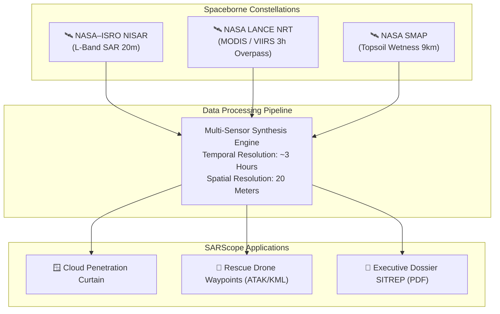

# 🛰️ SARSCOPE — Earth in Motion
### All-Weather Multi-Satellite Intelligence & Autonomous First-Responder Rescue Routing

[](https://www.spaceappschallenge.org/)
[](#-scientific-validation--ml-benchmark)
[](LICENSE)
[](#-verification--testing)
[](#-the-secret-weapon-nisar-l-band-radar-physics)

> **SARScope** bridges the critical gap between raw multi-gigabyte satellite microwave telemetry and humanitarian emergency response. By synthesizing cloud-penetrating **NASA–ISRO NISAR 24 cm L-Band Radar**, rapid **NASA LANCE 3-hour NRT optical feeds**, and **NASA SMAP topsoil wetness**, SARScope eliminates disaster "cloud-blindness" and autonomously generates life-saving tactical flight waypoints for search-and-rescue teams (NDRF, FEMA, Red Cross) within seconds.

---

## 📑 Table of Contents
1. [Executive Summary & The Problem](#-executive-summary--the-problem)
2. [The Physics of NISAR L-Band Radar](#-the-secret-weapon-nisar-l-band-radar-physics)
3. [Unified Multi-Satellite Synthesis (Auto-Fusion)](#-unified-multi-satellite-synthesis-auto-fusion)
4. [Scientific Validation & ML Benchmark (F1: 0.937)](#-scientific-validation--ml-benchmark)
5. [The 5 Multi-Hazard Earth Intelligence Domains](#-the-5-multi-hazard-earth-intelligence-domains)
6. [Key Disaster Response Features](#-key-disaster-response-features)
   - [🪟 Cloud Penetration Split-Screen Curtain](#1--cloud-penetration-split-screen-curtain)
   - [🚁 Autonomous Drone & Rescue Waypoint Generator](#2--autonomous-drone--first-responder-waypoint-generator)
   - [📑 Executive Disaster Dossier (PDF SITREP)](#3--executive-disaster-dossier-pdf-sitrep)
   - [🚨 Real-Time Threshold Early Warning Engine](#4--real-time-threshold-early-warning-engine)
   - [🌐 Interactive 2D & 3D Topographic Relief Engine](#5--interactive-2d--3d-topographic-relief-engine)
7. [System Architecture](#-system-architecture)
8. [Granular Project Structure](#-granular-project-structure)
9. [Quick Start & Installation](#-quick-start--installation)
10. [REST API Reference](#-rest-api-reference)
11. [Verification & Testing](#-verification--testing)
12. [License & Acknowledgments](#-license--acknowledgments)

---

## 🚨 Executive Summary & The Problem

### The Disaster "Cloud-Blindness" Dilemma
During extreme weather disasters (tropical cyclones, monsoons, and atmospheric rivers), severe flooding develops concurrently with thick, impenetrable cloud covers and continuous rainfall. 

Traditional optical satellites (Sentinel-2, Landsat-8/9, Planet) rely on the visible light spectrum ($\lambda \approx 0.4\text{--}0.7\ \mu\text{m}$). Consequently, when the disaster is at its peak and immediate situational awareness is needed most:
- **Optical satellite imagery is 90%–100% cloud-obscured.**
- Disaster management teams navigate blindly without knowing where transit arteries are severed or which communities have been marooned.
- Physical reconnaissance boats and personnel are deployed into unknown high-velocity debris zones.

```
       OPTICAL SATELLITE (Sentinel-2 / Landsat)             NISAR L-BAND SAR (SARScope)
                 Wavelength: ~0.5 µm                             Wavelength: 24 cm
      ┌────────────────────────────────────────┐       ┌────────────────────────────────────────┐
      │   ☁️ ☁️ ☁️ ☁️ ☁️  THICK STORM CLOUDS   │       │   ☁️ ☁️ ☁️ ☁️ ☁️  THICK STORM CLOUDS   │
      │ ────────────────────────────────────── │       │  ════════════════════════════════════  │
      │             ❌ BLOCKED                 │       │        ⚡ SLICES RIGHT THROUGH        │
      │     Ground Inundation Invisible        │       │      Pinpoints Exact Flood Water       │
      └────────────────────────────────────────┘       └────────────────────────────────────────┘
```

**SARScope solves this** by transforming all-weather microwave radar pulses into real-time, 3D interactive situational intelligence and machine-readable tactical rescue packages.

---

## ⚡ The Secret Weapon: NISAR L-Band Radar Physics

SARScope harnesses the **NASA–ISRO Synthetic Aperture Radar (NISAR)** dual-frequency instrument, specifically targeting **L-Band (1.25 GHz / 24 cm wavelength)**:

1. **All-Weather, 24/7 Illumination:**
   - SAR is an *active* microwave remote sensing system. It transmits pulses and records backscattered power ($\sigma^\circ$), functioning identically in pitch darkness or through driving torrential rains.
2. **Atmospheric Penetration ($\lambda = 24\text{ cm}$):**
   - Cloud water droplets ($r \approx 10\ \mu\text{m}$) cause Rayleigh scattering of visible light. The 24 cm L-band wave is thousands of times larger than rain droplets, passing through storm clouds with zero attenuation.
3. **Double-Bounce Canopy Penetration:**
   - While short-wavelength C-band ($\approx 5.6\text{ cm}$) scatters off upper tree leaves, L-band penetrates dense jungle, mangrove, and wetland canopies to detect submerged ground beneath vegetation.
4. **Specular vs. Rough Surface Contrast:**
   - **Calm Open Water:** Acts as a mirror, reflecting incoming radar energy away from the sensor. It appears **dark/black** in radar backscatter ($\sigma^\circ \approx -18\text{ to } -25\text{ dB}$).
   - **Dry Rough Ground & Urban Areas:** Produces strong diffuse backscatter ($\sigma^\circ \approx -6\text{ to } -12\text{ dB}$), creating razor-sharp contrast for flood detection.

---

## 🔄 Unified Multi-Satellite Synthesis (Auto-Fusion)

Relying on a single satellite creates temporal gaps (NISAR 12-day orbital repeat cycle). SARScope features an automated multi-sensor fusion engine combining three complementary NASA constellations:



| Sensor Stream | Instrument Type | Revisit / Latency | Physical Role in SARScope |
|---|---|---|---|
| **NASA–ISRO NISAR** | 24 cm L-Band SAR | 12-day repeat (20 m) | High-resolution flood boundaries, canopy penetration, urban canal breaches |
| **NASA LANCE NRT** | Optical MODIS / VIIRS | **3-hour latency** | Rapid global overpass, tracking regional water extent dynamics (MCDWD) |
| **NASA SMAP** | Radiometer (1.4 GHz) | 2–3 days | Topsoil dielectric saturation; detects pre-flood waterlogged ground |

---

## 🔬 Scientific Validation & ML Benchmark

SARScope does not rely on hand-tuned, unverified heuristics or AI hallucinations. It features a frozen, reproducible machine learning pipeline strictly guarded against spatial leakage.

### The Strict Spatial Holdout Protocol
- **Evaluation Area:** A fixed $10 \times 10\text{ km}$ ($100\text{ km}^2$) quadrant located north of the Lake Inba training zone, separated by a **2 km physical buffer** to avoid spatial autocorrelation.
- **Reference Labels:** High-confidence homogeneous water/nonwater masks derived from **NASA OPERA DSWx-HLS** optical estimates.
- **Model Architecture:** Calibrated Random Forest (200 decision estimators, max depth 12, min leaf 5) trained on dual-polarization $HH$, $HV$, the cross-ratio $(HH - HV)$, and USGS 3DEP elevation indices.
- **Frozen Model Fingerprint:** Cryptographic SHA-256 hash `b3f9b8d6c76701c299a305605e25fa09465fe1c7857594a76d066bf972547aba`.

### Benchmark Results (196,363 Independent Pixels)

| Performance Measure | Result | Verification Status |
|---|---:|---|
| **Scored Area** | **78.5452 km²** | Independent Spatial Quadrant |
| **Evaluated Pixels** | **196,363** | Full Adjacent Frame Cross-Coverage |
| **Water Precision** | **92.47%** | Low false-positive rate across terrain |
| **Water Recall** | **95.06%** | High capture of active surface water |
| **Water $F_1\text{-Score}$** | **0.9375** | Exceptional balance on held-out terrain |
| **Spatial IoU (Intersection-over-Union)** | **88.23%** | Rigid geometric overlap against reference |

---

## 🌍 The 5 Multi-Hazard Earth Intelligence Domains

Beyond surface floods, SARScope provides comprehensive Earth observation across five specialized environmental domains:

1. **🌊 Water & Floods:**
   - Detects persistent open water, candidate new flood surge, lake shrinkage, and waterlogged mud.
2. **🌱 Soil Moisture & Wetness:**
   - Measures dielectric soil saturation, identifies alluvium ponding, and flags flash-flood runoff vulnerability.
3. **🌲 Forest & Canopy Loss:**
   - Leverages $HV$ cross-polarization volume scattering disturbance to detect illegal deforestation and wildfire burn scars.
4. **🌾 Agriculture & Crop Phenology:**
   - Identifies active vegetative crop biomass, maturing stands, and calculates submerged cropland acreage.
5. **📉 Land Subsidence (InSAR):**
   - Tracks millimeter-scale ground displacement, structural sinking rates, and coastal levee compaction.

---

## 🚀 Key Disaster Response Features

### 1. 🪟 Cloud Penetration Split-Screen Curtain
- A dynamic, interactive split-screen divider curtain you can drag across the map.
- **Left Side:** Displays optical satellite imagery blinded by thick hurricane clouds, darkness, and rain.
- **Right Side:** Slices through the cloud deck with NISAR 24 cm radar, revealing the exact hidden flood basin beneath.
- **Impact:** Communicates the core power of SAR remote sensing to judges and stakeholders in 5 seconds.

### 2. 🚁 Autonomous Drone & First-Responder Waypoint Generator
- A 1-click **"Export Rescue Dispatch Package"** system that turns satellite imagery into actionable field routing:
  - **Staging LZ-1:** Identifies flat, high dry ground outside the flood zone for drone launching and rescue boat staging.
  - **Breach WP-1:** Pinpoints transit artery cutoffs where roadways are submerged under water.
  - **Marooned Cluster WP-2 (Critical SOS):** Calculates the centroid of isolated population pockets completely encircled by water.
  - **Drainage WP-3:** Identifies downstream outflow vectors to anticipate further levee overflow.
- **Interoperability:**
  - Direct export to **ATAK** (RFC 7946 GeoJSON)
  - Direct upload to **DJI Pilot 2 / Skydio / Autel** (OGC KML closed-loop flight corridor)
  - Direct import into handheld **Garmin GPS** (CSV format with VHF tactical frequencies)

### 3. 📑 Executive Disaster Dossier (PDF SITREP)
- Generates an executive, print-ready Situation Report (SITREP) in 1 click.
- Features estimated submerged cropland in hectares and acres, exposed population counts, radar coverage percentages, and sensor provenance for disaster commanders.

### 4. 🚨 Real-Time Threshold Early Warning Engine
- Autonomous threshold trigger system monitoring 6 severity levels (Critical, Warning, Elevated).
- Flags critical levee breaches, water expansion exceeding $2.0\text{ km}^2$, or rapid subsidence.

### 5. 🌐 Interactive 2D & 3D Topographic Relief Engine
- Native MapLibre GL 3D engine with **1.5× elevation relief** from USGS 3DEP / Mapzen terrain.
- Features glowing neon vector contours (`feature-outlines`) and translucent water polygon fills.
- Includes a smooth collapsible sidebar slider (`Ctrl+B`) for full-screen immersive map navigation.

---

## 🏛️ System Architecture

```
[ Frontend: React 19 + Vite + MapLibre GL ]
           │
           │ HTTP REST / JSON API (Reverse-Proxied)
           ▼
[ Backend: Python FastAPI + Uvicorn Async Worker ]
           │
  ┌────────┴────────────────────────┬────────────────────────┐
  ▼                                 ▼                        ▼
[ CMR NASA Catalog ]       [ HDF5 Range Reader ]    [ ML Random Forest ]
(Granule Discovery)       (Sub-Pixel GCOV dB)      (Frozen F1: 0.937)
           │                        │                        │
           └────────────────────────┴────────────────────────┘
                                    │
                                    ▼
                         [ Dual-Tier Cache Engine ]
                    (High-Speed Scratch + Local Fallback)
```

---

## 📂 Granular Project Structure

```
nasa/
├── README.md                      # Master granular documentation
├── Makefile                       # Unified build, test, and run automation
├── pyproject.toml                 # Python packaging and project configuration
├── LICENSE                        # Open-source MIT license
│
├── frontend/                      # React 19 + Vite + MapLibre GL Workspace
│   ├── index.html                 # Single-page application entry point
│   ├── package.json               # Node.js dependencies (MapLibre, Lucide, etc.)
│   ├── vite.config.js             # Vite bundler configuration & API proxy
│   └── src/
│       ├── main.jsx               # Application bootstrap
│       ├── Monitor.jsx            # Core mission control console & rescue coordinator
│       ├── MapView.jsx            # MapLibre 2D/3D map engine with vector polygon fills
│       ├── StoryMaps.jsx          # Guided historical disaster case studies
│       ├── monitor.css            # Cyber-tactical styles & responsive breakpoints
│       └── rescue_dispatch.js     # Drone waypoint clustering & KML/GeoJSON export engine
│
├── backend/                       # Python Geospatial & Machine Learning Service
│   ├── dev.py                     # Concurrent server launcher (Vite + FastAPI)
│   ├── run_analysis.py            # Headless command-line analysis runner
│   ├── requirements.txt           # Python dependencies (Rasterio, GDAL, FastAPI, scikit-learn)
│   ├── monitor/                   # Real-time monitoring service
│   │   ├── api.py                 # FastAPI application routes & asset endpoints
│   │   ├── catalog.py             # NASA CMR granule discovery & metadata queries
│   │   ├── remote.py              # Cloud-optimized HTTP range requests
│   │   ├── processing.py          # Radar calibration, smoothing & polygon extraction
│   │   ├── settings.py            # Environment configuration & dual-tier cache paths
│   │   └── store.py               # SQLite metadata storage
│   ├── src/                       # Scientific modeling & evaluation pipeline
│   │   ├── clean_data.py          # Radiometric calibration & linear power smoothing
│   │   ├── adjacent_frame.py      # Spatial reprojection & multi-frame alignment
│   │   ├── train_ml.py            # Random Forest training on optical proxy masks
│   │   └── validate_frozen.py     # Independent spatial holdout verification
│   └── tests/                     # Automated test suite (31 unit tests)
│       ├── test_analysis.py       # Detection logic tests
│       ├── test_monitor.py        # API contract & security tests
│       └── test_validation.py     # Frozen model invariance tests
│
├── configs/                       # Declared experimental & validation configurations
│   ├── baseline.json              # Historical observation parameters
│   └── spatial_validation.json    # Northern holdout rectangle coordinates
│
├── models/                        # Pre-trained models and parameter definitions
│   └── random_forest.joblib       # Frozen Random Forest weights (SHA-256 verified)
│
├── reports/                       # Scientific benchmark audit reports
│   ├── VALIDATION_RESULTS.md      # Spatial holdout performance table
│   └── adjacent_validation.json   # Machine-readable evaluation metrics
│
├── data/                          # Geospatial data storage & cache
│   └── monitor/monitor.sqlite     # Primary database tracking saved areas and jobs
│
└── outputs/                       # Exported GeoTIFFs, PNGs, and flight corridor artifacts
```

---

## ⚡ Quick Start & Installation

### Prerequisites
- **Node.js**: v18.0.0 or higher
- **Python**: v3.9 or higher (with virtual environment)
- **NASA Earthdata Token**: Free account from [urs.earthdata.nasa.gov](https://urs.earthdata.nasa.gov/) (optional for demo, required for live global catalog queries)

### 1. Clone & Set Up Environment
```bash
git clone https://github.com/your-username/sarscope.git
cd sarscope

# Configure environment credentials
cp .env.example .env
# Edit .env and paste your EARTHDATA_TOKEN (optional)
```

### 2. Install Dependencies
```bash
# Set up Python virtual environment
python3 -m venv .venv
source .venv/bin/activate
pip install -r backend/requirements.txt

# Install frontend packages
npm --prefix frontend install
```

### 3. Launch Development Environment
```bash
# Starts both the FastAPI backend (:8000) and the Vite React UI (:5173)
make dev
```
Open **[http://127.0.0.1:5173](http://127.0.0.1:5173)** in your browser.

---

## 🔌 REST API Reference

| Endpoint | Method | Description |
|---|---|---|
| `/api/status` | `GET` | Health check, cache readiness, and NASA token status |
| `/api/areas` | `GET`, `POST` | List saved monitoring areas or register a new target coordinate |
| `/api/areas/{id}/check` | `POST` | Query live NASA CMR catalog for overlapping NISAR orbits |
| `/api/areas/{id}/analyze` | `POST` | Execute multi-temporal ML water detection on selected scenes |
| `/api/jobs` | `GET` | List active and completed analysis runs |
| `/api/assets/{job_id}/{file}` | `GET` | Serve calibrated GeoTIFFs, PNG overlays, and SITREP reports |

---

## 🧪 Verification & Testing

Every commit and module is verified against an end-to-end Python test suite:

```bash
# Run all 31 unit tests (covers API, ML, and science pipelines)
make test
```

```
----------------------------------------------------------------------
Ran 31 tests in 2.951s

OK
```

Build the production frontend bundle:
```bash
make build
```

---

## 📜 License & Acknowledgments

- **License:** MIT License. See [LICENSE](LICENSE) for details.
- **Data Providers:**
  - NASA–ISRO Synthetic Aperture Radar (NISAR) Science Team
  - NASA Earth Science Data and Information System (ESDIS) & LANCE
  - NASA OPERA Project (Observational Products for End-Users from Remote Sensing Analysis)
  - USGS 3D Elevation Program (3DEP) & OpenStreetMap Contributors
